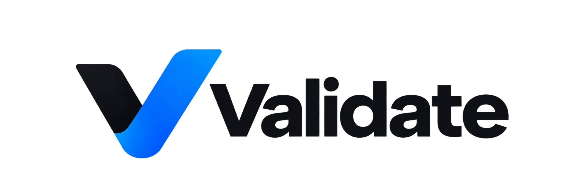
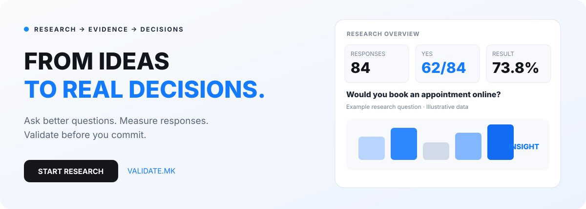

[Македонски](README.mk.md) · [English](README.md) · [Shqip](README.sq.md) · [Türkçe](README.tr.md)

  

 

### Fikirlerden gerçek kararlara.

**Fikirlerden gerçek kararlara.**

---

## Karar vermeden araştırın

**[Validate.mk](https://validate.mk)**, **[PROCESS IN](https://processin.mk)** araştırma ve anket platformudur. Şirketlerin, kurumların ve girişimcilerin karar öncesinde fikir, ürün ve çözümleri gerçek katılımcılarla test etmesine yardımcı olur.

Yalnızca form oluşturucu değildir. Araştırma sorularını, ölçülebilir yanıtları, yorumlamayı ve uygulanabilir kararları tek akışta bağlar.

## Fikirden kanıta

| Aşama | Anlamı |
|---|---|
| **01 — Soruyu tanımla** | Değerlendirilecek fikir, ürün, hizmet veya kararı belirleyin. |
| **02 — Anket oluştur** | Uygun soru biçimleriyle yapılandırılmış yanıt toplayın. |
| **03 — Kanıt topla** | Yanıt ve katılımı araştırma verisi olarak inceleyin. |
| **04 — Analiz et** | Yanıt sayılarını, yüzdeleri ve göstergeleri değerlendirin. |
| **05 — Yorumla** | Veriyi ilk araştırma sorusuna bağlayın. |
| **06 — Karar ver** | Bulgularla fikri geliştirin, ilerletin veya yeniden düşünün. |

## Anlamlı araştırma

| Alan | Kullanım |
|---|---|
| **Anket ve soru formları** | Yapılandırılmış geri bildirim toplama araçları. |
| **Yanıt analitiği** | Katılım, yanıt dağılımı ve sayısal göstergeler. |
| **Fikir ve ürün doğrulama** | Talep, kullanılabilirlik ve müşteri ilgisi varsayımlarını test etme. |
| **Karar desteği** | Yeni yöne yatırım öncesinde kanıtı yorumlama. |
| **Yinelemeli araştırma** | Sonuç belirsizse soruları geliştirip yeni turlar yürütme. |
| **Farklı ekipler** | Girişimci, ürün ekibi, kurum ve kuruluşlar. |

Ana görseldeki sayılar örnektir; gerçek müşteri araştırması veya kullanım iddiası değildir.

## Görüş toplamaktan fazlası

Amaç ölçülebilir yanıt, anlaşılır sonuç ve karar temelidir. Soruları hazırlayın, ilgili katılımcılardan yanıt toplayın, göstergeleri inceleyin ve ek araştırma gereken yerleri belirleyin. Zaman ve kaynak ayırmadan önce varsayımları test edin.

**Sor → Araştır → Anla → Karar ver**

### Daha iyi sorular. Daha iyi kanıtlar. Daha iyi kararlar.

[Araştırmaya başlayın](https://validate.mk)

## Ürün bilgileri

| Ayrıntı | Değer |
|---|---|
| Ürün | Validate |
| Resmî site | [validate.mk](https://validate.mk) |
| Kategori | Anket, pazar araştırması ve fikir doğrulama |
| Durum | LIVE |
| Geliştirici | [PROCESS IN](https://processin.mk) |
| Portföy | [PROCESS IN](https://github.com/stambolce/process-in) |

### [Ziyaret edin: Validate](https://validate.mk)

Herkese açık sunumdur; özel uygulama kodu değildir. Kullanıcı verisi veya özel araştırma yayımlanmaz, açık kaynak lisansı verilmez. Kullanılabilirlik güncel yapılandırma ve koşullara bağlıdır.

---

This platform is a digital product of <a href="https://processin.mk" target="_blank" >PROCESS IN </a>· Your Enterprise Software & AI Partner ·  Hosted on Enterprise Infrastructure by <a href="https://inhost.mk" target="_blank">INHOST</a>·
